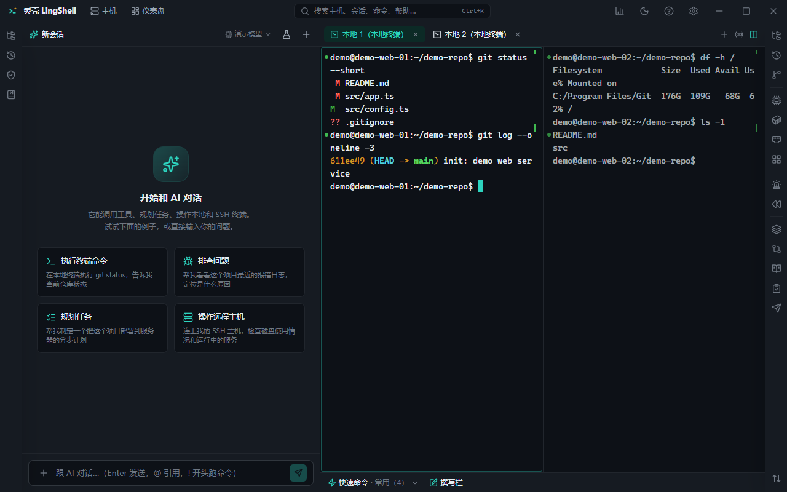

# 灵壳 LingShell

> 会思考的终端 · 运维工作台：AI 排查和执行，你掌控每一步。

[](LICENSE)
[](#安装)
[](#项目状态)
[](https://github.com/whoiam2007s/LingShell/actions/workflows/ci.yml)

[English](README.en.md) · 简体中文 · [功能详解](#功能详解)

灵壳是一个开源的 AI 终端与运维工作台：左边是 AI 对话，右边是本地终端和 SSH 主机。AI 在你授权后执行命令、读取结果、继续下一步；执行前有授权卡、危险命令确认、执行计划和回滚方案，执行后有完整执行记录。



- **本地优先**：配置、主机会话、审计和密钥都在你自己的机器上；模型 API Key 由你自己提供（BYO Key）。
- **不锁定模型**：DeepSeek、通义千问、Kimi、Ollama、OpenAI 兼容端点、Anthropic Messages 协议。
- **面向真实运维**：多主机、文件传输、Git、数据库、Docker、Kubernetes、定时巡检、证书、合规、部署评审、日志与排障。
- **安全可控**：应用锁、密钥保险箱、按主机授权、命令规则、AI 复核、预演模式、限时提权、本地审计。

> 当前是早期版本（0.1.x），接口、配置格式和功能都可能变化。请先在测试环境使用。

## 功能

### AI 与终端

- 本地终端（Windows Git Bash / PowerShell / cmd / WSL，macOS / Linux shell）与 SSH 终端。
- AI 对话、工具调用、授权卡、执行计划、回滚方案、执行记录、本轮文件改动与撤销。
- 分屏、广播输入、标签固定 / 颜色 / 重命名、tmux 断线保持、命令成败标记、命令历史、自动补全、快速命令、撰写栏、关键字高亮与告警。
- 附件 / 图片、Skills、MCP、知识库、跨主机提问、主机仪表盘。

### 文件与开发

- 资源管理器（本地 / SFTP）、上传下载、断点续传、双栏管理、sudo 模式、目录同步、文件预览、外部编辑器回传。
- 报错定位（`文件:行号` / VS Code Remote）、配置解释、配置按键对比、Git 面板、接口调试。
- 本机 / 远程 Docker、Compose、Kubernetes、MySQL / PostgreSQL / Redis / MongoDB 快查与备份。

### 运维与安全

- 主机体检、配置漂移、变更快照、监听端口、进程、服务、日志（tail / 多主机合流 / 历史检索）、连通性探测、磁盘分析。
- 定时巡检、看门狗、证书巡检、基线合规、部署评审、群机器人推送、告警一键 AI 排查。
- 应用锁、密钥保险箱、命令规则、危险命令确认、AI 复核、预演模式、sudo 限时提权、执行记录、终端录像与会话日志。
- 手机在局域网查看会话、处理授权（只读 + 授权，不能发消息）。

### 功能详解

每块功能怎么用、细节和注意事项单独成篇（中英双语）：

| 主题 | 内容 |
| --- | --- |
| [AI 对话与执行](guide/zh/ai-chat.md) | 授权卡、执行计划、回滚方案、执行记录、上下文与附件、Skills / MCP / 知识库 |
| [终端](guide/zh/terminal.md) | 本地与 SSH、分屏与广播、搜索、快速命令、撰写栏、高亮告警、命令标记、即时回放 |
| [主机与连接](guide/zh/hosts.md) | 主机与分组、导入、密钥与凭据、跳板 / 代理 / ProxyCommand、端口转发、OTP、断线重连 |
| [文件与传输](guide/zh/files.md) | 资源管理器、SFTP 上传下载、断点续传、双栏、sudo 模式、外部编辑器、目录同步 |
| [Git](guide/zh/git.md) | 改动与差异、暂存提交、分支 / 合并 / rebase / stash、blame、AI 提交说明 |
| [数据库](guide/zh/database.md) | MySQL / PostgreSQL / Redis / MongoDB 查询、结果导出、备份、慢日志 |
| [容器与 K8s](guide/zh/containers.md) | 本机 / 远程 Docker、Compose、Kubernetes |
| [运维与排障](guide/zh/ops.md) | 主机体检、配置漂移、日志、端口 / 进程 / 服务、磁盘、连通性、部署评审、批量执行 |
| [自动化与巡检](guide/zh/automation.md) | 定时巡检、看门狗、证书巡检、基线合规、群机器人推送、快速命令、运维手册 |
| [安全与设置](guide/zh/security.md) | 应用锁、密钥保险箱、授权规则、危险命令、AI 复核、预演、审计、数据与更新、手机访问 |

## 安装

从 [Releases](https://github.com/whoiam2007s/LingShell/releases) 下载对应平台的安装包。

- **Windows**：`LingShell-<版本>-win-x64.exe`（NSIS，当前未签名，SmartScreen 会提示）。
- **macOS / Linux**：构建配置已提供，尚未充分验证；欢迎参与测试。
- 首次启动在「设置 → 模型设置」填入你自己的 API Key；没有 Key 时不会发起任何模型请求。

> 安装包目前未签名。下载后请核对发布页的 SHA256；企业环境建议使用自己构建的签名版本。

## 安全模型

- **本地优先**：业务数据在 `~/.lingshell`，浏览器数据 / 系统密钥链绑定在系统用户目录；不上传到灵壳服务器。
- **AI 不会静默执行**：默认每条命令按主机授权；生产主机写操作逐条确认；危险命令强制确认。
- **密钥不落明文**：API Key、主机密码 / 私钥、保险箱值经系统密钥链加密；发给模型前可按设置脱敏。
- **可审计**：执行记录、授权、回滚、文件改动都可追溯；支持导出会话报告。
- **无默认遥测**：不收集使用数据；你配置的模型 / Webhook / MCP 等第三方服务除外。

安全漏洞请按 [SECURITY.md](SECURITY.md) 私下报告，不要公开 issue。

## 开发

前置：Node.js ≥ 18、pnpm 9、Git。Windows 上本地终端需要 Git for Windows（Git Bash）；开发 node-pty 可能需要 VS Build Tools，打包使用其自带预编译件。

```bash
pnpm install
pnpm dev        # 前端 dev server + Electron（自动等待前端就绪）
pnpm test       # 单元 / 集成测试
pnpm typecheck
pnpm lint
pnpm check:structure   # 目录边界、IPC 协议三方一致、循环依赖检查
pnpm dist:win   # Windows 安装包（仓库根目录 release/）
```

工程结构：

```
apps/
  desktop/        Electron 主进程 + preload + IPC 装配
  ui/             React 前端（Vite）
packages/
  shared/         客户端契约、事件、纯逻辑与类型
  terminal-core/  本地 / SSH 终端、命令捕获、互斥锁
  dsh-controller/ DeepSeek Harness 会话与工具封装
  auth-registry/  授权与危险命令检测
  config/         设置 / 主机 / 会话 / 布局持久化
  platform/       路径与日志
cli/              外部 agent 调用本地 API 的脚本
docs/             设计、迁移与功能说明
scripts/          结构检查、i18n 检查等仓库脚本
```

主进程、共享协议、前端 IPC 实现按同一组领域（terminal、ai、ops、files、git、db、integrations、mobile、app）分目录，跨目录只经 `index.ts` 引用。新功能放哪、加 IPC 通道要改哪几处，见 [CONTRIBUTING.md 的「代码结构」](CONTRIBUTING.md#代码结构)。

## 项目状态与边界

- 当前仓库是**社区版**：单机、本地数据、完整安全能力，永久免费，Apache-2.0。
- 团队协作 / 集中治理（共享凭据、集中策略与审批、集中审计、SSO/RBAC、远程中继、私有化等）会作为独立的商业 Team / Enterprise 版本提供，见 [COMMERCIAL.md](COMMERCIAL.md)。
- 我们承诺：**不把现有单机功能挪进付费墙，安全修复永远免费**。

## 贡献

欢迎 issue、文档、测试和 PR。提交前请阅读 [CONTRIBUTING.md](CONTRIBUTING.md) 与 [CODE_OF_CONDUCT.md](CODE_OF_CONDUCT.md)。首次贡献需要同意 [CLA](CLA.md)（用于保留商业版与双许可所需的授权）。

## 许可证与商标

- 代码：[Apache License 2.0](LICENSE)。
- 名称与 Logo：[TRADEMARK.md](TRADEMARK.md)。
- 第三方组件：[THIRD_PARTY_NOTICES.md](THIRD_PARTY_NOTICES.md)。
- 隐私说明：[PRIVACY.md](PRIVACY.md)。

灵壳 LingShell 与 Logo 是项目商标；未经许可不得用于修改版分发或暗示官方认可。

## 联系

- 维护者：BigZ
- 邮箱：whoiam2007s@163.com
- 安全漏洞请按 [SECURITY.md](SECURITY.md) 私下报告。
