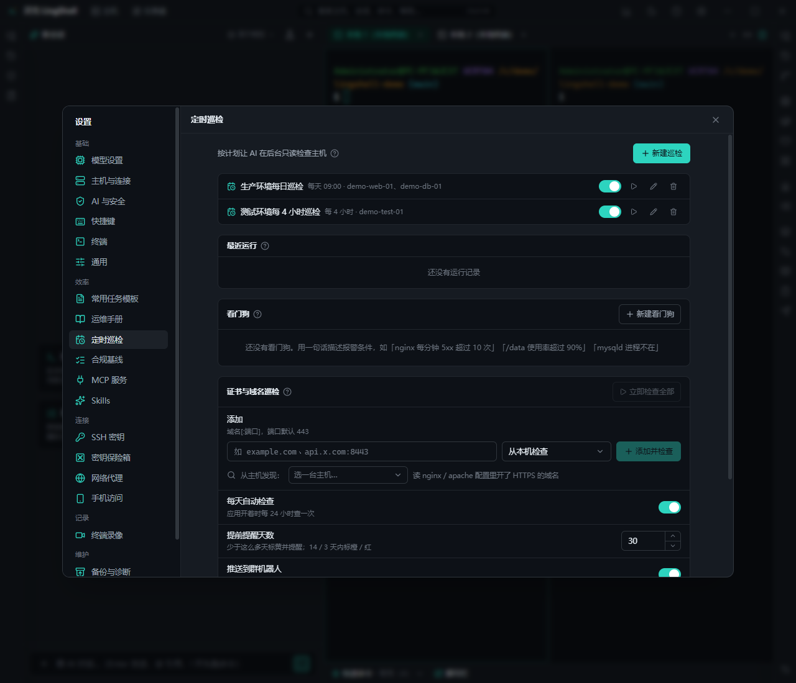

# Automation & inspections

Turn "the things you check every day" into scheduled jobs that tell you when something breaks, and turn what you did once into a reusable runbook.

## What you get

- **Scheduled inspections**: run a set of checks on a cron schedule (host checkup, disk, log keywords, service state, …); results are stored and only anomalies are surfaced.
- **Watchdog**: describe the alert condition in natural language (e.g. "tell me if disk goes above 85% or nginx dies"), the AI evaluates it on a schedule.
- **Certificate and domain checks**: expiry dates plus DNS / connectivity, run "from this machine" or "from a host" for internal sites.
- **Baseline compliance**: define baseline rules (SSH config, password policy, risky ports) and check hosts in bulk with the failing items listed.
- **Alert push**: DingTalk / Feishu / WeCom group bots receive inspections, watchdog alerts, certificate expiry and deploy results.
- **Quick commands**: save commands as button groups (global / group / host) and fire them from the bottom bar; the AI can draft a group for you.
- **Runbooks**: capture multi-step procedures (checks and changes) as parameterised steps you can execute later — or generate one from a run log in one click.
- **Templates**: reusable command / script skeletons.
- **Auto-reply**: answer recurring prompts (passphrase prompts, `[y/N]` confirmations) with preset input to avoid stalls.

## How to use it

1. **Do it manually first**: walk through the inspection or fix in the chat or terminal.
2. **Save it as a runbook or quick command**: ask the AI to turn it into a runbook (it will promote hosts, paths and other variables to parameters).
3. **Schedule it**: choose checks, frequency, target host group and notification channel under "Scheduled inspections".
4. **Add a watchdog**: one sentence describing the condition plus a check interval.
5. **Act on alerts**: open the alert from the chat-bot message and let the AI continue the investigation.

## Notes

- Inspections are read-only by default; steps that change a system require separate approval and never run silently.
- Scheduled jobs depend on this desktop app running locally — nothing runs while the machine is off.
- Pushed messages include host names and summaries; keep the visibility of the group bot in mind.

## Related

- [Ops & troubleshooting](ops.md) · [Security & settings](security.md) · [AI chat & execution](ai-chat.md)
