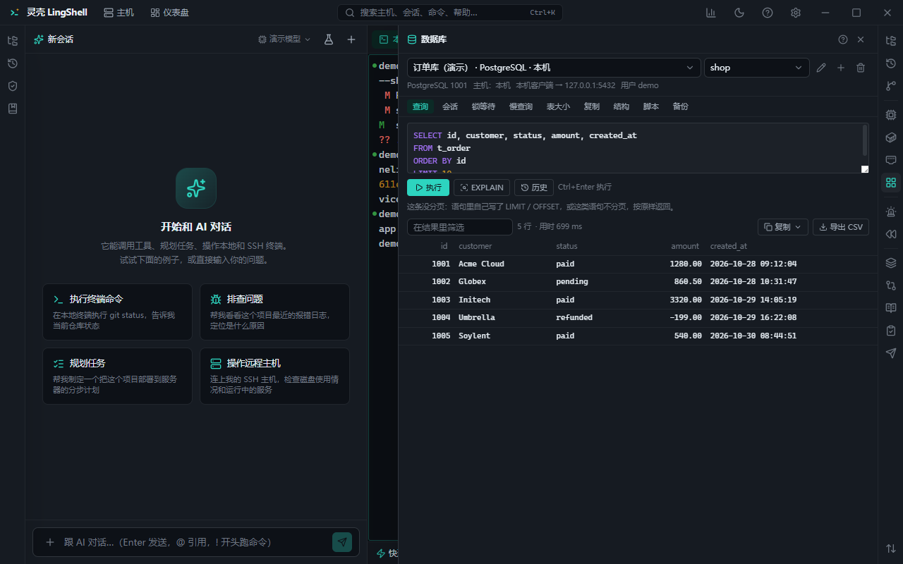

# Database

Quick access and backups for MySQL / PostgreSQL / Redis / MongoDB: connect, query, inspect schema, export and back up without installing a fleet of clients.

## What you get

- **Connections**: save MySQL / PostgreSQL / Redis / MongoDB connections (direct or through an SSH host); passwords live in the secret vault.
- **Query panel**: run SQL, Redis commands or Mongo queries with a syntax-highlighted editor.
- **Result grid**: sortable columns, horizontal scrolling for wide tables, copy cell / row / whole table as CSV, TSV, Markdown or INSERT statements.
- **Read-only protection**: queries run in a read-only transaction by default (MySQL sets a read-only transaction, PostgreSQL uses a `--csv` read path) to avoid accidental writes in production.
- **Schema view**: tables, indexes and constraints; PostgreSQL can reconstruct a `CREATE TABLE` from columns, constraints and indexes.
- **Ad-hoc queries**: a single read-only statement only; multiple statements are rejected.
- **Switch database / schema** with identifier validation.
- **Redis**: INFO sections, `CLIENT LIST`, `--bigkeys` digest, key browsing (hash / zset pairs, SSCAN paging), client `kill`.
- **Slow logs**: fetch MySQL / PostgreSQL slow logs and digest them (grouping, time distribution).
- **Backups**: MySQL (`mysqldump` + gzip), PostgreSQL (`pg_dump -Fc`), Mongo (`mongodump`) — run in the background, with size and free-space estimation and a retention policy.
- **Exports**: save query results to files.
- **Error translation**: common failures (insufficient privilege, bad credentials, unreachable) get human-readable explanations instead of raw errors.

## How to use it

1. Add a connection: host / port / database / user, store the password in the vault; pick a jump host if needed.
2. Write the statement in the query panel, check the result grid, then decide whether to export.
3. For backups, pick database and tables, choose a target directory, and let it run in the background.
4. For slow queries, pull the slow-log digest and let the AI combine it with execution plans.

## Notes

- Passwords never appear on the command line (env / stdin) and never reach the model context.
- Writes (UPDATE / DELETE / DDL) require approval; validate your conditions with a SELECT in a read-only transaction first.
- Backups land in `~/lingshell-backups/<connection>/` by default; low disk space is reported beforehand.

## Related

- [Ops & troubleshooting](ops.md) · [Hosts & connections](hosts.md) · [AI chat & execution](ai-chat.md)
