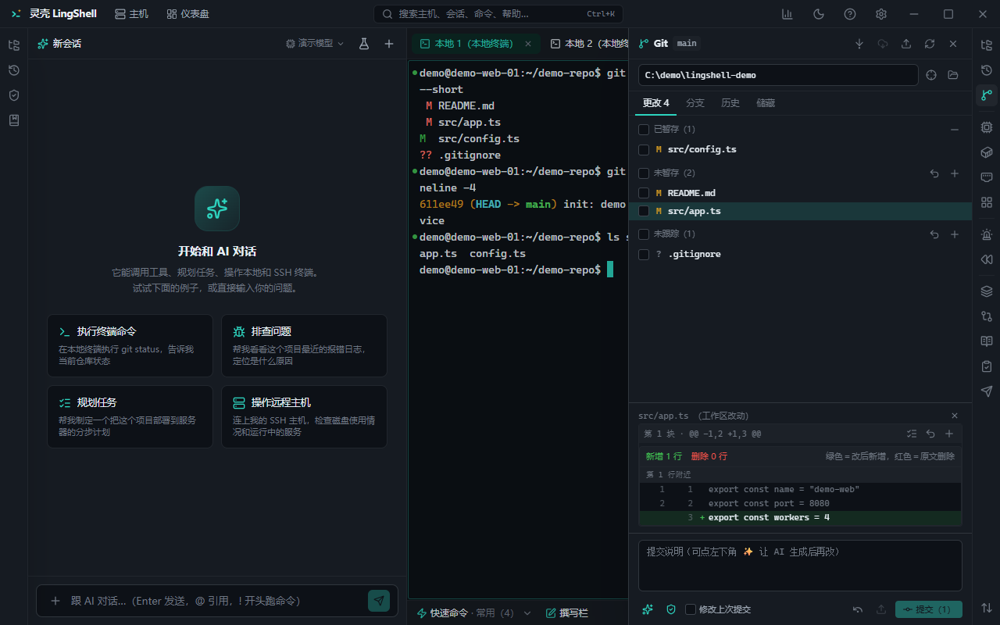

# Git

Review changes, stage, commit and switch branches without leaving LingShell — and let the AI write the commit message from the actual diff.

## What you get

- **Repo detection**: open any directory and the panel finds its repository and current branch (subdirectories included).
- **Change list**: untracked / unstaged / staged side by side.
- **Diffs**: per-file diff view, including content of untracked files.
- **Stage / unstage**: per file, no `git add -p` memorisation.
- **Commit**: write a message and commit, with the staged content visible first.
- **AI commit messages**: generate a conventional message from the real diff, edit it if you like.
- **Branches**: list, create, switch, delete; each with its latest commit.
- **Merge / rebase**: start a merge and resolve conflicts; conflict list plus two-sided diff markers.
- **Stash**: stash, restore and list.
- **History**: browse commits and see what each changed.
- **Blame**: line-by-line authorship.
- **Compare**: diff between branches or commits.
- **Remotes**: inspect remote URLs, pull and push (using your system git configuration and credentials).

## How to use it

1. Open the repo folder in the explorer, then switch to the Git panel.
2. Review changes → select files → stage.
3. Click "AI commit message", review, then commit.
4. Switch branches from the branch list; uncommitted work prompts you to stash first.

## Notes

- It uses the `git` already installed on your machine — credentials, hooks and config behave as usual.
- Repositories with `.git/hooks` will run their hooks on commit.
- Merge and rebase rewrite history; the AI never does them on its own, you confirm in the panel.

## Related

- [Files & transfer](files.md) · [Terminal](terminal.md) · [AI chat & execution](ai-chat.md)
