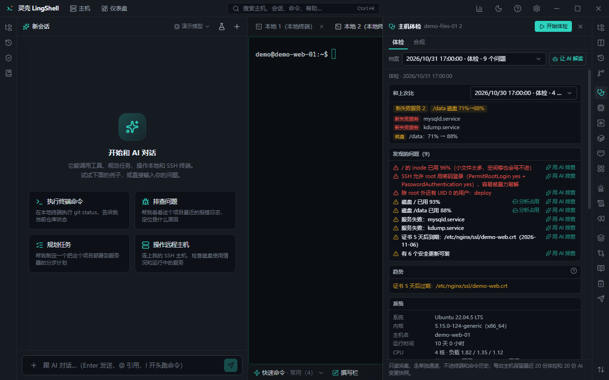

# Ops & troubleshooting

Day-to-day inspection and debugging, turned into views you can read at a glance: host checkup, drift, logs, ports, processes, services, disk, connectivity and multi-host batches.

## What you get

- **Host checkup**: a single pass collecting CPU, memory, load, disk, network and key services, parsed into a profile with problems flagged.
- **Compare with last time (config drift)**: diff two checkups of the same host — who changed what, which ports appeared.
- **Change snapshots**: before an AI write the app snapshots state, then snapshots again at the end of the turn; differences are reported for rollback reference.
- **Logs**:
  - per-host tail (can follow);
  - multi-host logs merged into one stream;
  - historical search including rotated `.gz` files;
  - log insight: grouping of similar errors, time distribution, anomalies.
- **Ports**: listening sockets with process, address and protocol — spot the unexpected one.
- **Processes**: sort by CPU / memory, see command line and owner, kill with approval.
- **Services**: systemd state, start / stop, enable at boot, recent logs.
- **Disk**: partition usage and large-directory analysis (which level eats the space).
- **Connectivity probe**: from this machine or from several hosts to targets (`host:port`, URL, domain), summarised in a table.
- **Topology**: a simple map built from host groups and connections.
- **Deploy review**: run pending commands / config through a review that flags risky parts before execution.
- **Batch execution**: one command across many hosts with aggregated output and per-host success / failure; supports staged rollout (canary / rolling).
- **Host dashboard**: live CPU, memory, network and disk I/O charts.
- **Trends**: key metrics retained over time.

## How to use it

1. **Routine checkup**: pick a host group → run checkup → review flagged items; the next run compares automatically.
2. **Debugging**: dashboard and ports first, then logs (merge across hosts if needed), then let the AI reason over the whole context.
3. **Before changing config**: deploy review, confirm the risks, execute, then inspect the change snapshot.
4. **Multi-host work**: batch execution with staged batches — validate on one host first.

## Notes

- Read-only actions (logs, ports, processes) need no approval; killing processes, restarting services and editing config require approval and are logged.
- Batch execution is high-risk: test the command on a single host first.

## Related

- [Automation & inspections](automation.md) · [Terminal](terminal.md) · [Database](database.md) · [Security & settings](security.md)
