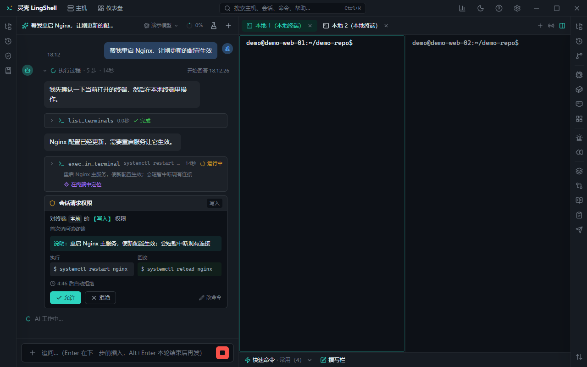

# AI 对话与执行

左边是 AI 对话，右边是终端和主机。AI 不是"聊天框里给建议"，而是**在终端里真正干活**：读命令输出、决定下一步、改文件、查主机；每条动手的命令都要你点头，执行前后都有记录。

## 能做什么

- **对话即运维**：AI 可以调用工具跑命令、读日志、改文件、查数据库、操作容器，结果回到对话里继续推理。
- **授权卡**：AI 要执行命令时先弹卡，写清命令、影响和风险；你点允许才执行，也可以拒绝或改成只读。
- **执行计划**：多步操作可以一次性列成计划，你批准后按步执行，也可以删掉其中某几步。
- **回滚方案**：写操作要求同时给出撤销命令，执行记录里可一键回滚。
- **执行记录**：每条命令的时间、主机、命令、退出码、耗时、是否被拒都在，可导出。
- **上下文管理**：长会话自动压缩旧内容；可以手动重置、分叉出新会话。
- **附件与图片**：拖图、贴截图、附日志文件给 AI 看。
- **Skills / MCP / 知识库**：把团队规范做成 Skill、把外部工具接成 MCP、把主机事实存成知识卡，AI 会按需取用。
- **@ 引用**：`@` 直接引用某台终端、某台主机或某个历史会话，让 AI 针对它分析。
- **`!` 开头**：在输入框以 `!` 开头的命令直接在当前终端执行，不经过 AI。
- **提问卡**：AI 遇到需要选择的情况会弹选项卡（单选 / 多选），你选完它继续。
- **把终端内容交给 AI**：选中终端里的输出，一键送进对话当上下文。
- **会话搜索**：会话内搜索、跨会话搜索，以及"问 AI：上次怎么修好的"。
- **导出**：会话报告（Markdown / HTML）、故障复盘报告（固定模板）。
- **通知**：AI 跑完、长命令结束、需要授权时，托盘与系统通知提醒。

## 怎么用

1. **配置模型**：设置 → 模型设置 → 填自己的 API Key（BYO Key），选提供商和模型。没有 Key 时不会发任何模型请求。
2. **新建对话**：左侧输入问题；先用 `@` 指定终端 / 主机，AI 才知道在哪干活。
3. **看授权卡**：读清楚命令再点允许；生产主机的写命令默认每条都要确认。
4. **盯执行记录**：在对话的步骤区或执行记录面板里看每条命令的结果，失败就直接让 AI 排查。
5. **收尾**：本轮改过的文件可以整体撤销；满意就把会话导出成报告。

## 安全边界

- AI **不会静默执行**：默认按主机授权，生产主机写操作逐条确认，危险命令强制二次确认。
- 密钥与密码不会进模型上下文：发给模型前按设置脱敏；AI 看不到明文。
- 预演模式（只说不做）可以先看 AI 打算做什么，再决定是否真的执行。
- 详见[安全与设置](security.md)。

## 相关

- [终端](terminal.md) · [主机与连接](hosts.md) · [安全与设置](security.md) · [运维与排障](ops.md)
