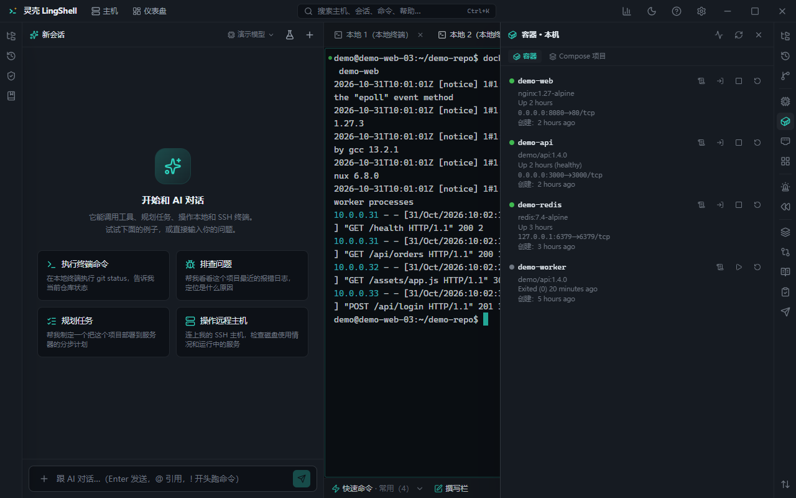

# 容器与 K8s

本机和远程主机上的 Docker、Compose、Kubernetes 都能在面板里看，不必来回敲 `docker ps` / `kubectl get`。

## 能做什么

- **Docker（本机 / 远程）**：容器列表、状态、镜像、端口、启动时间；启动 / 停止 / 重启 / 删除。
- **容器日志**：跟随（follow）看实时日志，支持搜索与导出。
- **容器内执行**：在容器里开一个 shell 或执行单条命令。
- **Compose**：识别 compose 项目与服务的对应关系，按项目查看 / 操作。
- **Kubernetes**：使用本机 `kubectl` 配置（context / namespace 可切换）查看 Pod、Deployment、Service、Node 等；看事件、日志、describe。
- **远程经 SSH**：远程主机上的 Docker / K8s 走同一条 SSH 连接，不用另开隧道。
- **AI 联动**：容器异常、Pod 反复重启时可以让 AI 结合日志和事件分析。

## 怎么用

1. 打开容器面板，选本机或某台主机。
2. 先看列表和状态，异常容器直接看日志。
3. 需要进容器排查时开 shell（写操作会走授权）。
4. K8s 场景先切 context / namespace，再按资源类型浏览。

## 注意

- 删除容器、重建服务这类操作不可逆，默认需要授权确认。
- 生产集群上建议只读浏览 + 让 AI 分析，改动走你们的发布流程。

## 相关

- [运维与排障](ops.md) · [主机与连接](hosts.md) · [自动化与巡检](automation.md)
