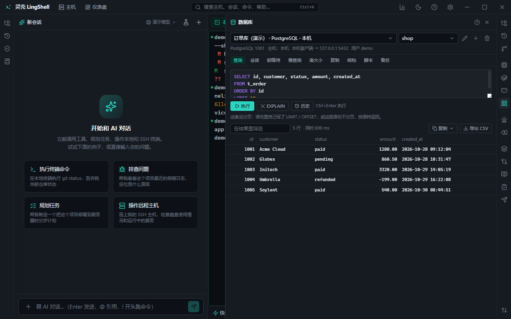

# 数据库

MySQL / PostgreSQL / Redis / MongoDB 的快查与备份面板：连上就能查、能看结构、能导出、能备份，不用装一堆客户端。

## 能做什么

- **连接管理**：保存 MySQL / PostgreSQL / Redis / MongoDB 连接（本机或经 SSH 主机），密码进保险箱。
- **查询面板**：写 SQL / Redis 命令 / Mongo 查询并执行；带语法高亮的输入区。
- **结果表**：表格展示、列排序、宽表横向滚动、复制单元格 / 行 / 整表（CSV / TSV / Markdown / INSERT 语句）。
- **只读保护**：默认把查询放进只读事务（MySQL 先设只读事务，PG 用 `--csv` 只读通道），避免手滑写生产。
- **表结构**：查看表结构、索引、约束；PG 可由字段 + 约束 + 索引拼出建表语句。
- **即席查询**：只接受单条只读语句，多语句会被拒。
- **切库 / 切 schema**：校验名字后切换。
- **Redis**：INFO 分节、CLIENT LIST、`--bigkeys` 摘要、Key 浏览（hash / zset 成对展示、SSCAN 分页）、`kill` 客户端。
- **慢日志**：拉取 MySQL / PG 慢日志并做摘要（同类归并、时间分布）。
- **备份**：MySQL（`mysqldump` + gzip）、PostgreSQL（`pg_dump -Fc`）、Mongo（`mongodump`），后台执行、估算大小与剩余空间、保留策略。
- **还原**：备份列表里点某一行的还原按钮直接恢复（MySQL / PostgreSQL / MongoDB）。默认直接还原；想留回滚点就在确认框里勾「还原前先备份当前库」，快照文件名带 `prerestore`。还原结束会自动数一下目标库有多少对象，给出「还原完成：当前库有 N 个对象」。
- **导出**：查询结果导出成文件。
- **错误翻译**：常见错误（权限不够、账号密码不对、连不上）给出中文说明，而不是原始报错。

## 怎么用

1. 新增连接：填地址 / 端口 / 库名 / 账号，密码存保险箱；需要跳板时选主机。
2. 在查询面板里写语句，先看结果表对不对，再决定是否导出。
3. 需要备份时选库和表，指定保存目录，后台跑完给结果。
4. 需要还原时在备份列表点该行的还原按钮：勾「我了解这会覆盖…」后开始；想留回滚点再勾「还原前先备份当前库」。
5. 排查慢查询：拉慢日志摘要，再让 AI 结合执行计划分析。

## 注意

- 密码不会出现在命令行里（走环境变量 / stdin），也不会进模型上下文。
- 写操作（UPDATE / DELETE / DDL）默认需要授权确认，建议先在只读事务里跑 SELECT 验证条件。
- 备份文件默认落在 `~/lingshell-backups/<连接名>/`，可用空间不足会提前提示。
- 还原会覆盖目标库现有数据，且不可撤销；勾了「先备份」才会多出一份 `*-prerestore-*` 快照文件，不勾就直接还原。
- **Windows 本机也能备份 / 还原**（走内置的 Git Bash），不必为了备份去连一台 Linux 主机；缺 `mysqldump` / `pg_dump` / `mongodump` 时会提示「这台机器上没有 xxx」。

## 相关

- [运维与排障](ops.md) · [主机与连接](hosts.md) · [AI 对话与执行](ai-chat.md)
