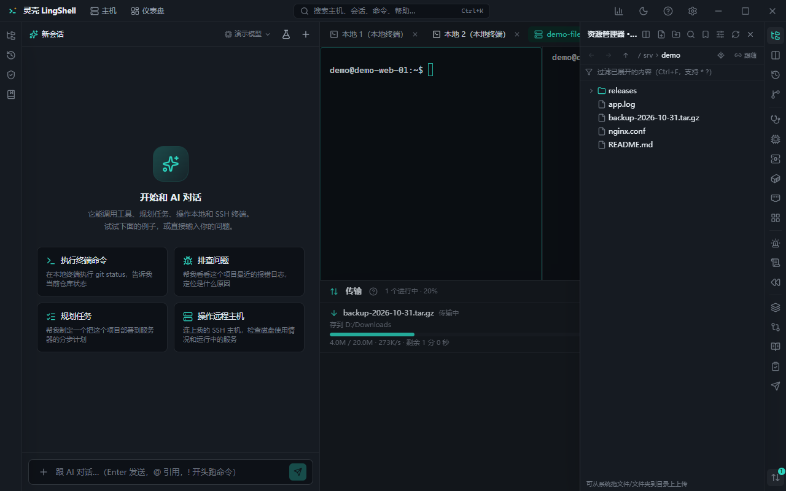

# 文件与传输

本地和远程文件用同一套界面：看、搜、改、传、比、同步。不用记 `scp` / `rsync` 参数，也不用另开一个 SFTP 客户端。

## 能做什么

- **资源管理器**：本地目录与远程主机（SFTP）同界面浏览；记住展开状态与历史。
- **上传 / 下载**：文件、目录、多选、拖拽都行；队列里看进度、暂停、取消、重试。
- **断点续传**：网络中断后续传，不从头再来。
- **双栏文件管理**（类 WinSCP）：左本地右远程，拖过去就是传输。
- **sudo 模式**：没权限的目录 / 文件，用 sudo 读取或写入（会走授权与审计）。
- **文件属性与权限**：查看 / 修改 `chmod`、属主；远程同样支持。
- **压缩与解压**：远程打包（zip / tar.gz）后再传，比传一堆小文件快。
- **目录书签**：常去的路径存成书签。
- **按名称搜索 / 快速过滤**：大目录里定位文件。
- **编辑与预览**：内置编辑器直接改（保存前后有差异提示）；图片、PDF、表格、Office 文档可预览。
- **用本地编辑器打开**：调 VS Code 等外部编辑器改远程文件，保存后自动回传；远端在此期间被改过会提示冲突（覆盖 / 另存 / 放弃）。
- **跟随终端目录**：终端 `cd` 到哪，资源管理器跟到哪。
- **拖文件到终端**：把文件拖进终端自动填路径（传路径给命令很方便）。
- **传输队列**：批量传输排队执行，失败可单独重试。
- **目录比较与同步**：本地 ⇄ 远程比较差异，按需单向或双向同步。
- **Windows 服务器**：对自带 OpenSSH 的 Windows 主机同样可用。

## 怎么用

1. 打开资源管理器，选本地或某台主机。
2. 需要双向搬运时切到双栏模式，直接拖。
3. 改远程配置：双击打开内置编辑器，或用本地编辑器打开（保存自动回传）。
4. 权限不够的路径开 sudo 模式（会弹授权）。
5. 大目录迁移：先远程压缩，再下载，再解压。

## 注意

- 覆盖前会自动备份（远程编辑回传、覆盖写入都会留副本）。
- sudo 模式的每一步写操作都进执行记录，可回滚（有备份时）。
- 传输大文件时留意目标盘剩余空间（备份 / 传输前会估算）。

## 相关

- [终端](terminal.md) · [主机与连接](hosts.md) · [Git](git.md) · [安全与设置](security.md)
