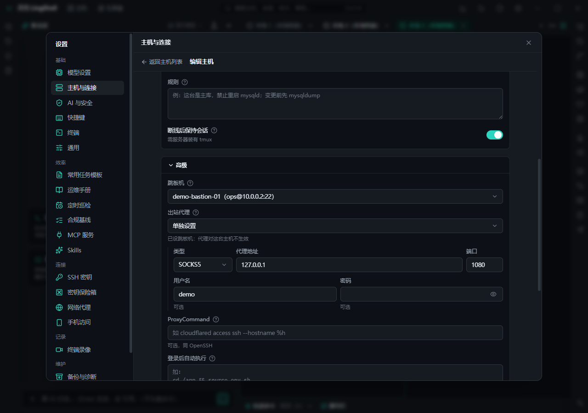

# 主机与连接

把一堆零散的 SSH 连接变成可管理的主机清单：分组、凭据复用、跳板与代理、断线保持，都配好一次，之后 AI 和人都按同一份配置干活。

## 能做什么

- **主机管理**：保存主机（地址、端口、用户名、认证方式、分组、环境标记），支持分组与工作区。
- **批量修改**：一次改多台主机（端口、用户、代理等）。
- **导入**：从 `~/.ssh/config`、Xshell、PuTTY、MobaXterm、SecureCRT 等导入既有会话。
- **SSH 密钥**：生成、导入、选择密钥；查看指纹；部署公钥到目标机。
- **凭据复用**：多台主机共用一套账号密码 / 密钥，改一处全生效。
- **主机指纹**：首次连接确认并记住指纹，指纹变了会警告（防中间人）。
- **ssh-agent / Pageant**：复用系统代理里的密钥，不必每次输密码。
- **跳板机与代理**：跳板（Jump host）、出站代理（HTTP / SOCKS5）、`ProxyCommand` 三种方式，按网络环境选。
- **端口转发与 SOCKS5**：本地转发、远程转发、动态 SOCKS5 代理，可在界面里加规则、看状态、在浏览器打开。
- **登录后自动执行**：连上后自动跑指定命令（切目录、设环境、装工具）。
- **高级选项**：agent 转发、心跳间隔、连接超时、保持活动。
- **tmux 保持会话**：断线重连后终端现场还在（远端需有 tmux）。
- **断线自动重连**：网络抖动时自动重连并在终端上方提示。
- **二次验证**：支持 OTP（TOTP）与堡垒机式的交互登录流程。
- **主机面板 / 仪表盘**：CPU、内存、网络、磁盘 IO、磁盘占用一览；连不通时直接看到原因。
- **`ssh://` 链接**：点击 `ssh://user@host:port` 直接打开连接。
- **生产主机标记**：标了"生产"的主机，写操作默认逐条确认（见[安全与设置](security.md)）。

## 怎么用

1. **加第一台主机**：主机面板 → 新建 → 填地址 / 用户 / 认证 → 保存。
2. **确认指纹**：首次连接核对指纹后记住。
3. **分组管理**：按环境（生产 / 测试）或业务分组，后续授权、批量操作、巡检都按分组来。
4. **复杂网络**：先试直连，不通再加跳板或代理；内网工具链用 `ProxyCommand`。
5. **端口转发**：在主机详情里加规则，需要时一键启用。

## 注意

- 主机密码 / 私钥 / 口令都经系统密钥链加密存储，不落明文。
- 标记为生产的主机，AI 的每条写命令都要你确认；标错环境会导致该拦的没拦，建议一开始就分清。

## 相关

- [终端](terminal.md) · [文件与传输](files.md) · [运维与排障](ops.md) · [安全与设置](security.md)
