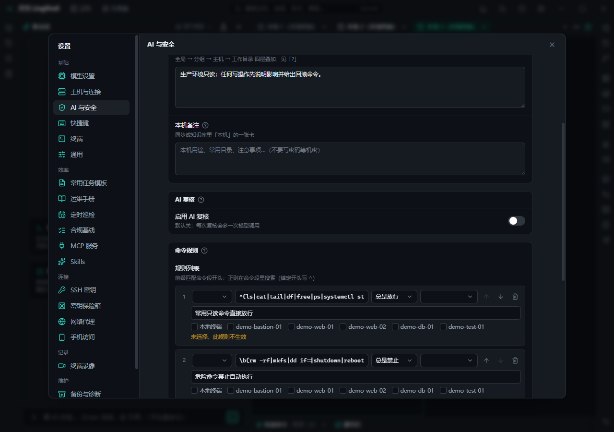

# 安全与设置

灵壳的默认假设是：**AI 会犯错，网络会被人盯上，生产环境不容许"手滑"**。所以授权、脱敏、审计都是默认开启的。

## 授权与拦截

- **按主机授权**：默认每条命令按主机授权；每台主机可以单独设信任档（逐条确认 / 只读免确认 / 免确认）。
- **生产主机**：标为生产的主机，写操作逐条确认，且不接受"本次都允许"。
- **危险命令**：`rm -rf /`、`mkfs`、`dd of=/dev/sd*`、改防火墙、关机重启等强制二次确认。
- **命令规则**：用规则匹配放行 / 询问 / 禁止（正则或前缀），团队约定可以固化成规则。
- **AI 复核**：高风险命令可交给第二个模型复核，独立判断"这条该不该跑"。
- **预演模式**（只说不做）：AI 只输出打算做什么，不实际执行；确认后再关掉预演跑一遍。
- **sudo 限时提权**：需要 sudo 时临时提权，到期自动收回。
- **规则分层**：全局 → 分组 → 主机 → 工作目录，越具体优先级越高。

## 数据安全

- **密钥保险箱**：API Key、主机密码、私钥、保险箱值经系统密钥链（Windows DPAPI / macOS Keychain / Linux Secret Service）加密存储，不落明文。
- **发给 AI 前脱敏**：密码、token、连接串等按规则替换成占位符，模型只看到占位符。
- **应用锁**：离开工位一键锁屏（`Ctrl+Shift+L`），回来输密码；支持开机自动锁。
- **审计与记录**：每次授权、执行、回滚、文件改动都留痕；可导出审计记录。
- **终端录像与会话日志**：可选录制终端输出与会话日志，出事时能回看。
- **诊断包**：导出问题诊断信息时自动脱敏，不会把密钥 / 密码带出去。
- **无遥测**：默认不收集使用数据；只有你配置的模型 / webhook / MCP 等第三方服务会收到数据。

## 设置与数据

- **模型设置**：提供商、模型、接口协议（OpenAI 兼容 / Anthropic Messages）、多套配置切换。
- **数据目录**：业务数据在 `~/.lingshell`（配置、主机、会话、审计、日志、录像）。
- **备份**：配置可整体导出 / 导入；支持定时备份。
- **更新**：打包版可检查更新（是否启用取决于构建时是否配置更新源）；从不强制重启。
- **外观**：主题、界面缩放、图标大小、语言（简体中文 / English）。
- **快捷键**：全部可自定义。
- **手机访问**：局域网内用手机浏览器查看会话、处理授权（只读 + 授权，不能发消息），需要配对码。

## 怎么用

1. 第一次启动：设应用锁密码 → 填模型 API Key → 给主机标好生产 / 测试。
2. 按团队习惯配命令规则和信任档（生产一律逐条确认最稳）。
3. 需要更稳的操作时用预演模式先看一遍。
4. 定期导出备份；怀疑泄露时用诊断包（已脱敏）排查。

## 相关

- [AI 对话与执行](ai-chat.md) · [主机与连接](hosts.md) · [自动化与巡检](automation.md)
