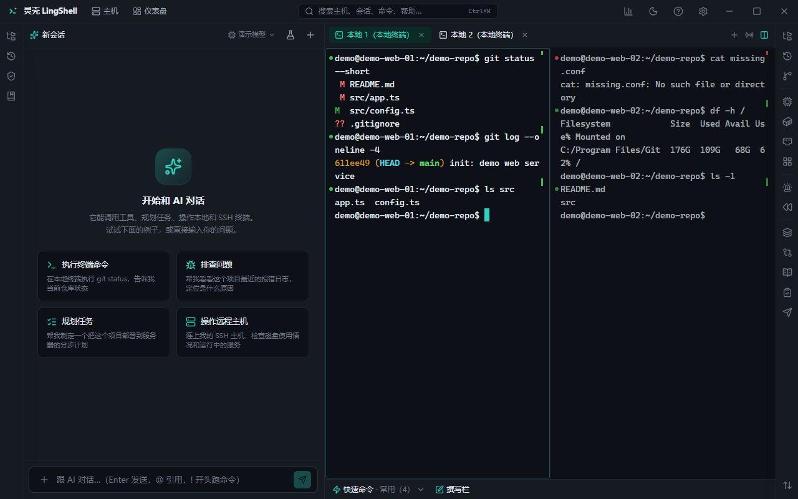

# 终端

灵壳的终端是"给 AI 用"的终端：命令和输出可被结构化捕获、可回溯、可交给 AI 分析，同时保留你熟悉的手感（xterm.js + 原生 PTY，不是网页模拟）。

## 能做什么

- **本地终端**：Windows 上支持 Git Bash、PowerShell、cmd、WSL；macOS / Linux 用系统 shell。
- **SSH 终端**：连远程主机的完整交互式会话，支持跳板、代理、密钥、OTP（见[主机与连接](hosts.md)）。
- **标签**：新建、重命名、固定、按颜色区分；标签间快速切换。
- **分屏布局**：左右 / 上下分屏，一屏盯日志一屏敲命令。
- **广播输入**：一处输入，多台终端同时执行（批量改配置、同时看几台机器的输出）。
- **终端内搜索**：在缓冲区里搜关键字并跳转。
- **快速命令**：把常用命令存成按钮，按主机 / 分组复用，底部一点即发。
- **撰写栏**：长命令、多行脚本先在撰写栏里写，检查后再发进终端。
- **关键字高亮与告警**：命中关键字（如 `error`、`OOM`）时高亮；可设为告警，触发时提示并可让 AI 排查。
- **命令成败标记**：每条命令结束在侧边留绿点 / 红点，左侧滚动条形成"执行条"，失败一眼看到。
- **单条命令操作**：复制该条命令、复制输出、重跑、把命令与输出一起附到对话里。
- **命令历史**：跨会话保存，可搜索、可重发；命令历史也会进入 AI 上下文（脱敏后）。
- **命令自动补全**：基于历史与常见命令，输入前缀即提示。
- **粘贴安全检查**：多行粘贴前提示，避免一次贴进去半屏命令。
- **即时回放**：把一次会话的终端输出按时间回放（默认 `Ctrl+Alt+R`），排查"刚才那一下到底输出了什么"。
- **快速选择**（默认 `Alt+S`）：终端里的路径、URL、IP、哈希直接选中复制或打开。
- **Quake 模式**：连按两下 `Alt` 呼出 / 收起终端。
- **导出缓冲区**：把当前屏幕或全部输出导出成文件。
- **字符编码**：可切换 GBK 等编码，处理中文乱码。
- **tmux 保持**：SSH 断线后会话还在，重连即续（见[主机与连接](hosts.md)）。
- **响铃提示与长命令完成通知**：跑得久的命令结束会提醒。

## 怎么用

1. 新建终端：选本地 shell 或已保存的主机。
2. 需要并行时用分屏；要同时对多台执行就用广播输入。
3. 常用命令存进快速命令；复杂命令先在撰写栏里打磨。
4. 命令失败：点侧边红点定位，直接让 AI 看这条命令和输出。
5. 排查历史问题时用即时回放或导出缓冲区。

## 小技巧

- `Ctrl+Shift+L` 锁屏（应用锁开启时），离开工位前按一下。
- 终端里的 `文件:行号`、URL、`ssh://` 链接都可以点击。
- 拖文件到终端会自动填路径。

## 相关

- [主机与连接](hosts.md) · [AI 对话与执行](ai-chat.md) · [文件与传输](files.md) · [运维与排障](ops.md)
